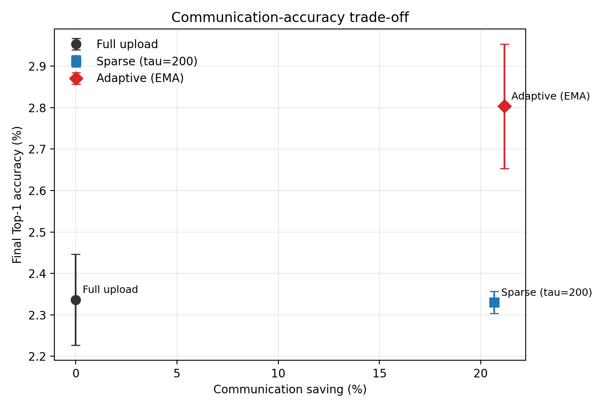

# AFDC: Adaptive Federated Distillation with CVAE

PyTorch implementation of **AFDC**, a federated knowledge-distillation
framework that uses class-conditional latent statistics as the communication
payload. AFDC combines generative class balancing with a drift-triggered
sparse communication scheduler.

## Highlights

- Uses class-level CVAE latent statistics instead of model parameters as the
  communication payload.
- Aggregates client statistics on the server and generates class-balanced
  virtual data for knowledge distillation.
- Measures client drift with the KL divergence between current and cached
  latent statistics.
- Supports three communication modes: full upload, fixed-threshold sparse
  upload, and adaptive thresholding with an EMA-scaled threshold.
- Supports CIFAR-10, CIFAR-100, and Fashion-MNIST.
- Includes the latest CIFAR-100 20-round x 3-repeat results and per-round logs.

## Latest CIFAR-100 Result

The main result uses Dirichlet partition (`alpha = 0.5`), 10 clients, 20
communication rounds, and three independent repeats.

| Method | Final Top-1 (%) | Best Top-1 (%) | Upload ratio | Communication saving |
|---|---:|---:|---:|---:|
| Full upload | 2.34 +/- 0.11 | 5.90 +/- 0.74 | 100.0% | 0% |
| Sparse, tau=200 | 2.33 +/- 0.03 | 5.78 +/- 0.75 | 79.3% | 20.7% |
| Adaptive | **2.80 +/- 0.15** | **5.97 +/- 0.91** | 78.8% | **21.2%** |

The absolute Top-1 is intentionally reported under the strict
client-encoder plus deterministic-transform protocol used to validate the
drift signal. The main comparison is between scheduling policies under the
same protocol.



## Repository Layout

```text
.
├── configs/                         # Experiment configuration
├── datasets/                        # Data loading and Dirichlet partitioning
├── models/                          # CVAE model definitions
├── results/                         # Latest summary, figures, and per-round logs
├── scripts/
│   └── make_portfolio_figures.py    # Rebuild result figures from history files
├── train_cifar10_teacher.py         # CIFAR-10 teacher pretraining
├── train_cifar100_teacher.py        # CIFAR-100 teacher pretraining
├── train_fashionmnist_teacher.py    # Fashion-MNIST teacher pretraining
├── run_cifar10_afdc.py              # CIFAR-10 experiments
├── run_cifar100_afdc.py             # CIFAR-100 experiments
└── run_fashionmnist_afdc.py         # Fashion-MNIST experiments
```

## Setup

Python 3.10 and a CUDA-capable PyTorch installation are recommended.

```bash
conda create -n afdc python=3.10
conda activate afdc
pip install torch torchvision --index-url https://download.pytorch.org/whl/cu118
pip install -r requirements.txt
```

Datasets are downloaded by `torchvision` on first use. Teacher weights are not
committed because the files are too large for a normal Git repository.

## Train the Teacher

```bash
python train_cifar100_teacher.py
```

The CIFAR-100 teacher is written to:

```text
output/cifar100_teacher/teacher_best.pt
```

Teacher training for CIFAR-10 and Fashion-MNIST can be started with the
corresponding `train_*_teacher.py` scripts.

## Reproduce the Main CIFAR-100 Experiment

```bash
python run_cifar100_afdc.py \
  --exp comm_adaptive \
  --partition dirichlet \
  --comm_taus 200 \
  --comm_beta 0.8 \
  --comm_tau_max 300
```

The command runs full upload, sparse upload with `tau=200`, and adaptive
thresholding. Each configuration is repeated three times using seeds 42, 123,
and 999.

For a short smoke test:

```bash
python run_cifar100_afdc.py \
  --exp comm_adaptive \
  --partition dirichlet \
  --quick \
  --comm_taus 200 \
  --comm_tau_max 300
```

## Rebuild Figures

```bash
python scripts/make_portfolio_figures.py
```

The script reads the checked-in per-round CIFAR-100 histories under
`results/histories/` and rebuilds the convergence, threshold, and
communication-accuracy figures.

## Notes

- CIFAR-100 is the final validation setting for adaptive scheduling.
- CIFAR-10 and Fashion-MNIST results in the accompanying paper are early
  comparisons and are not presented here as final repeated experiments.
- The repository excludes datasets, model weights, generated experiment
  directories, paper drafts, and legacy materials.
